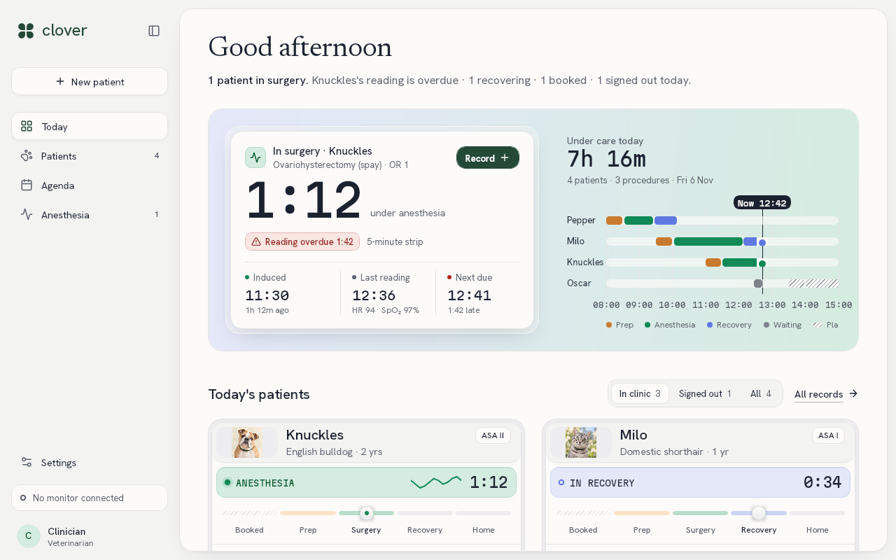

# Vigil

- **Owner:** Matthew Mattei (@noknowscode)
- **Status:** ready for review
- **What it is:** An anesthesia record for veterinary technicians: doses, vitals every five minutes, recovery and sign-off, local-first and bilingual.

Vigil is the anesthesia record for surgical vet techs in a small-animal hospital. The tech records:
- the pre-anesthetic check;
- weight-based doses;
- vitals every five minutes during the procedure;
- recovery.

The veterinarian signs the record. Vigil replaces the paper anesthesia sheet clipped to the anesthesia machine.



## What it shows

- **Today:** the patient in surgery, the time since induction, when the next reading is due, and a timeline of every
  patient's day. Below it, each patient's stage: booked, prep, surgery, recovery, home.
- **The patient record:** the pre-anesthetic check, vitals, medications, doses, labs, medical history and recovery.
  Each opens in a drawer beside the record.
- **Doses:** calculated from the patient's weight, with redose reminders.
- **Sign-off, export and corrections:** the veterinarian's sign-off, a pet-parent view, and a CSV export of the
  record. Case details can be corrected until sign-off, and each change is logged.
- **Other screens:** new patients, an agenda, and settings for the theme (light or dark) and the language (English or
  French).

The data stays on the device in a local JSON store. **Settings → Load sample day** fills it with a surgical day to try
the app with.

Drug concentrations, dose ranges and alarm thresholds are sample reference data, not for clinical use.

## Built with

- Uno Platform, with Uno.Sdk pinned in `global.json`: a single project for desktop, WebAssembly, Android, iOS and
  Windows (WinAppSDK).
- **MVUX:** the page and drawer models expose feeds and states, and pages bind with `{Binding}`.
- **Navigation Extensions:**
  - the shell's sections are region routes;
  - each record pane is a `!` route opened in the Uno Toolkit's `DrawerFlyoutPresenter`;
  - a sidebar shows on desktop, and a menu drawer on phones.
- **Material** theme with a custom token set, in light and dark.
- **Localization:** English and French `.resw` tables, written by `tools/localize.py`.

## Try it

You need the .NET 10 SDK; the Uno.Sdk version comes from `global.json`. Restore the workloads for the heads you build
with `dotnet workload restore`.

```bash
# Desktop
dotnet build Vigil/Vigil.csproj -f net10.0-desktop -p:VigilTargetFrameworks=net10.0-desktop
dotnet run --project Vigil/Vigil.csproj -f net10.0-desktop -p:VigilTargetFrameworks=net10.0-desktop

# WebAssembly
dotnet publish Vigil/Vigil.csproj -f net10.0-browserwasm -c Release -p:VigilTargetFrameworks=net10.0-browserwasm -o publish
# then serve publish/wwwroot with any static file server
```

In Visual Studio, Rider or VS Code, open `Vigil.sln` and pick a target.

## Tests

This folder holds the one app project Studio opens. The unit tests (NUnit: the domain rules, the store and every page
and drawer model) live in the development repository, [noknowscode/Vigil](https://github.com/noknowscode/Vigil).

## Layout

| Path | What is there |
|---|---|
| `Vigil/Domain/` | case records, dosing, the vitals schedule, care stages, the CSV export, the sample day |
| `Vigil/Services/` | the JSON case store, preferences, the record exporter, the clock, the formulary, the crash reporter |
| `Vigil/Presentation/` | the shell, Today and Agenda, Patients, the record and its drawers, Dose, Sign-off, the case form, the pet-parent view, Settings |
| `Vigil/Themes/`, `Vigil/Styles/` | tokens, type ramp and the Material colour override |
| `Vigil/Strings/` | English and French string tables |
| `docs/` | decisions, the completeness audit, the uno-audit, design notes and evidence |
| `.studiolive/` | the showcase info file, the Studio agent context and conversation, the icon and screenshots |

`SPEC.md` and `SPEC-v2.md` are the product spec, and `HANDOFF.md` is the latest working state.
